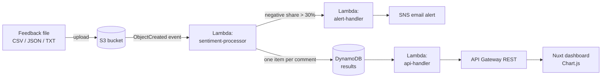

# Customer Feedback Sentiment Pipeline (AWS Serverless)

**Event-driven pipeline that turns raw customer feedback files into sentiment metrics, a live dashboard, and alerts — on the AWS free tier.**

`AWS S3` · `Lambda (Python)` · `DynamoDB` · `API Gateway` · `SNS` · `CloudWatch` · `CloudFormation / SAM` · `Nuxt + Chart.js`

## Business problem

Fintech support teams receive feedback through surveys, app reviews and tickets. Reading it manually is slow, and a spike in complaints is often noticed days late. This pipeline classifies every comment as it lands, aggregates sentiment by channel, and alerts the team when negative feedback crosses a threshold.

## Architecture



| Component | What it does |
|---|---|
| `backend/lambda/sentiment-processor` | Parses CSV/JSON/TXT from S3, scores each comment, writes results to DynamoDB, triggers alerts |
| `backend/lambda/api-handler` | REST endpoints: `/sentiment/summary`, `/sentiment/results`, `/sentiment/feedback` |
| `backend/lambda/alert-handler` | Negative-sentiment alerts, system alerts and summary reports via SNS |
| `backend/infrastructure` | CloudFormation + SAM templates (infrastructure as code) |
| `frontend-new` | Nuxt dashboard: sentiment distribution, trends by source, recent comments |

## Evaluating the classifier

To stay inside the free tier we used a **rule-based lexicon classifier** instead of Amazon Comprehend. I evaluated it against star ratings on the labelled demo set (4–5★ = positive, 3★ = neutral, 1–2★ = negative):

```
python analysis/evaluate_rules.py
```

| truth \ predicted | Positive | Neutral | Negative |
|---|---|---|---|
| **Positive** | 13 | 1 | 1 |
| **Neutral** | 1 | 2 | 1 |
| **Negative** | 0 | 2 | 9 |

**Accuracy: 80% (24 / 30).** The errors are informative:

- **No stemming** — "crashes" and "frustrating" are missed because the lexicon only contains "crashed" and "frustrated".
- **No negation** — "No major issues so far" is scored negative because of "issues".
- **Substring matching** — "unhelpful" also matches "helpful", and "dislike" matches "like".

**Next steps:** tokenize on word boundaries, add stemming and a negation window (or switch to VADER), and A/B the result against Amazon Comprehend on a larger labelled sample before trusting the alert threshold. 30 rows is a smoke test, not a benchmark.

## Run it

```bash
# Deploy the backend (needs AWS CLI + SAM CLI, your own account)
cd backend/infrastructure/sam
sam build && sam deploy --guided      # set NotificationEmail to your address

# Send a test file through the pipeline
aws s3 cp ../../../sample-data/customer-feedback-demo.csv s3://<your-bucket>/

# Run the dashboard
cd ../../../frontend-new && npm install && npm run dev
```

Detailed guides: [deployment](docs/DEPLOYMENT_GUIDE.md) · [system overview](docs/SYSTEM_OVERVIEW.md) · [full project report](docs/AWS_PROJECT_REPORT.md) · [slides](docs/Customer_Feedback_Sentiment_Analysis_Final_Presentation.pptx)

> The original deployment has been torn down to avoid AWS charges; account IDs and endpoints in this repo are placeholders.

## Repository structure

```
├── backend/
│   ├── lambda/              # sentiment-processor, api-handler, alert-handler
│   └── infrastructure/      # CloudFormation + SAM templates, deploy script
├── frontend-new/            # Nuxt + Chart.js dashboard
├── infrastructure/          # standalone CloudFormation variants, CloudFront config
├── sample-data/             # demo feedback in CSV / JSON / TXT
├── analysis/                # classifier evaluation
├── tests/                   # Lambda test payloads and recorded responses
└── docs/                    # guides, report, slides
```

## Team

Team project for Special Topics: Cloud Computing, M.S. Data Analytics & Visualization, Yeshiva University (Fall 2025).

- **Tapiwa Mutarimanja** — TODO: describe your part (e.g. Lambda processing logic, DynamoDB design, dashboard, evaluation)
- **Peter Mangoro** — TODO: confirm name and role
